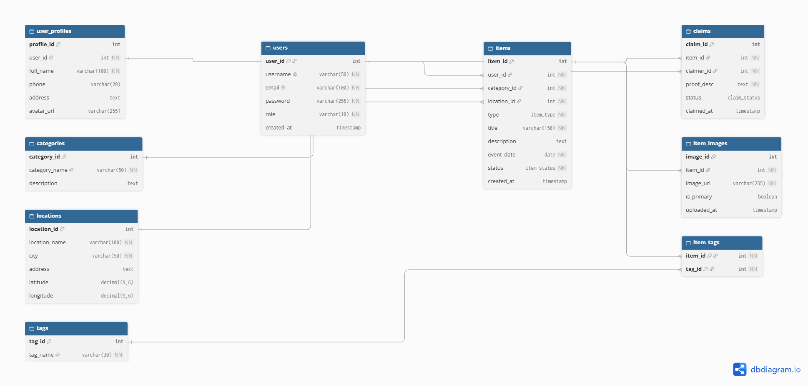

# FindBack — REST API Pencarian Barang Hilang

FindBack membantu pengguna melaporkan barang hilang, melaporkan barang ditemukan, mencari laporan berdasarkan nama/ciri-ciri, memperbarui status, dan menghapus laporan. Backend memakai Node.js, PostgreSQL, dan Vercel Functions. Frontend tidak termasuk karena tidak diwajibkan dalam tugas.

## Teknologi
- Node.js + Vercel Functions
- PostgreSQL (Neon atau Supabase)
- `pg` untuk akses database
- JSON untuk request/response

## Database dan ERD
Skema terdiri dari 9 tabel: `users`, `user_profiles`, `categories`, `locations`, `items`, `item_images`, `claims`, `tags`, dan `item_tags`. Ada relasi one-to-many dan many-to-many. Diagram DBML ada di `sql/erd.dbml`; SQL lengkap ada di `sql/schema.sql`.

**Catatan:** schema.sql mengikuti skema SQL yang disiapkan untuk FindBack. Perintah `DROP TABLE`/`DROP TYPE` di bagian awal akan menghapus tabel/tipe bernama sama, jadi jalankan hanya pada database baru atau setelah backup.

## Setup database
1. Buat database PostgreSQL di Neon atau Supabase.
2. Buka SQL Editor dan jalankan isi `sql/schema.sql`.
3. Salin connection string database. Pastikan SSL diaktifkan untuk database hosted.

## Jalankan lokal
1. Install Node.js LTS dan Vercel CLI (`npm install` akan memasang dependency lokal).
2. Salin `.env.example` menjadi `.env` lalu isi `DATABASE_URL`.
3. Jalankan:
   ```bash
   npm install
   npx vercel dev
   ```
4. Tes `http://localhost:3000/health`.

Jangan commit `.env` atau membagikan connection string. Password pada tabel users harus berupa hash jika fitur autentikasi ditambahkan; API starter ini belum mengimplementasikan login/authorization.

## Deploy ke Vercel
1. Push folder project ke repository GitHub.
2. Import repository di dashboard Vercel.
3. Tambahkan Environment Variable `DATABASE_URL` dengan connection string PostgreSQL.
4. Deploy. Base URL akan berbentuk `https://findback-backend-nine.vercel.app/`.
5. Tes `GET https://findback-backend-nine.vercel.app/health`.

## Format umum
- Header request JSON: `Content-Type: application/json`
- Response umumnya berbentuk `{ "data": ... }` atau `{ "message": "...", "data": ... }`.
- ID harus bilangan bulat positif.
- Nilai `type`: `lost` atau `found`.
- Nilai `status`: `open`, `claimed`, `returned`, `closed`.
- Query pencarian: `q`; filter opsional: `type`, `status`, `category_id`, `limit` (maksimum 100).

## Endpoint API

Base URL: `https://findback-backend-nine.vercel.app/`.

### 1. Health check
- Method: `GET`
- URL: `/health`
- Deskripsi: memeriksa apakah API aktif.
- Response `200`: `{ "message": "FindBack API aktif", "status": "ok" }`

### 2. Daftar laporan barang
- Method: `GET`
- URL: `/items`
- Deskripsi: daftar laporan barang hilang dan ditemukan.
- Contoh filter: `/items?type=lost&status=open&category_id=1&limit=20`
- Response `200`: `{ "data": [], "count": 0 }`

### 3. Cari barang
- Method: `GET`
- URL: `/items?q=dompet`
- Deskripsi: mencari berdasarkan judul, deskripsi, atau tag.
- Response `200`: `{ "data": [], "count": 0 }`

### 4. Detail laporan
- Method: `GET`
- URL: `/items/1`
- Response `200`: `{ "data": { "...": "..." } }`
- Error `404`: `{ "error": "Barang tidak ditemukan" }`

### 5. Tambah barang hilang
- Method: `POST`
- URL: `/items`
- Request body:
  ```json
  {
    "user_id": 1,
    "category_id": 1,
    "location_id": 1,
    "type": "lost",
    "title": "Dompet kulit coklat",
    "description": "Hilang di area stasiun",
    "event_date": "2026-10-01",
    "tags": ["coklat", "kulit"],
    "images": ["https://example.com/dompet.jpg"]
  }
  ```
- Response `201`: `{ "message": "Laporan barang berhasil ditambahkan", "data": { "...": "..." } }`
- Error `400`: field wajib tidak lengkap / referensi tidak valid.

### 6. Tambah barang ditemukan
- Method: `POST`
- URL: `/items`
- Request body sama dengan tambah barang hilang, ubah `"type": "found"` dan sesuaikan judul, deskripsi, tanggal, lokasi, kategori.

### 7. Update seluruh laporan
- Method: `PUT`
- URL: `/items/1`
- Deskripsi: mengganti seluruh field utama.
- Request body:
  ```json
  {
    "user_id": 1,
    "category_id": 1,
    "location_id": 1,
    "type": "lost",
    "title": "Dompet kulit coklat",
    "description": "Dompet sudah ditemukan",
    "event_date": "2026-10-01",
    "status": "returned"
  }
  ```
- Response `200`: `{ "message": "Data barang berhasil diperbarui", "data": { "...": "..." } }`

### 8. Update sebagian / status laporan
- Method: `PATCH`
- URL: `/items/1`
- Request body: `{ "status": "returned" }`
- Pilihan status: `open`, `claimed`, `returned`, `closed`.
- Response `200`: data laporan terbaru.

### 9. Hapus laporan
- Method: `DELETE`
- URL: `/items/1`
- Response `200`: `{ "message": "Data barang berhasil dihapus", "item_id": 1 }`
- Error `404`: barang tidak ditemukan.

### 10. Kategori
- `GET /categories` — daftar kategori
- `GET /categories/1` — detail kategori
- `POST /categories` — body `{"category_name":"Dokumen","description":"Kartu dan dokumen"}`
- `PUT /categories/1` — body `{"category_name":"Dokumen","description":"Kartu dan dokumen"}`
- `DELETE /categories/1` — hapus kategori jika tidak dipakai oleh laporan

### 11. Lokasi
- `GET /locations` — daftar lokasi
- `GET /locations/1` — detail lokasi
- `POST /locations` — body `{"location_name":"Perpustakaan","city":"Bandung","address":"Jl. Contoh"}`
- `PUT /locations/1` — body memuat `location_name` dan `city`, field lain opsional
- `DELETE /locations/1` — hapus lokasi jika tidak dipakai laporan

### 12. Tag
- `GET /tags` — daftar tag
- `GET /tags/1` — detail tag
- `POST /tags` — body `{"tag_name":"hitam"}`
- `PUT /tags/1` — body `{"tag_name":"hitam"}`
- `DELETE /tags/1` — hapus tag

## Status code
- `200`: berhasil membaca/mengubah/menghapus
- `201`: berhasil membuat data
- `400`: input tidak valid atau relasi FK tidak ada
- `404`: endpoint atau data tidak ditemukan
- `409`: data unik duplikat
- `500`: kesalahan server atau konfigurasi

## Pengujian Postman / Thunder Client
Import `postman/FindBack.postman_collection.json`, lalu ganti variable `baseUrl` dengan URL Vercel. Jalankan health check, GET kategori/lokasi untuk mengetahui ID, POST item, GET item, PATCH status, lalu DELETE item uji. Bukti screenshot request dan response perlu diambil setelah API live; collection tidak menggantikan bukti pengujian nyata.

## Batasan starter
- Endpoint claims belum disediakan meskipun tabel `claims` tersedia di database.
- Login, token, dan otorisasi belum dibuat. Jangan gunakan untuk data sensitif/produksi tanpa autentikasi dan pembatasan akses.
- Foto disimpan sebagai URL, bukan upload file langsung.

## ERD Database FindBack


## Link Project

- Repository GitHub: https://github.com/szfieee/Find-Back.git
- Deployment Vercel: https://findback-backend-nine.vercel.app/
